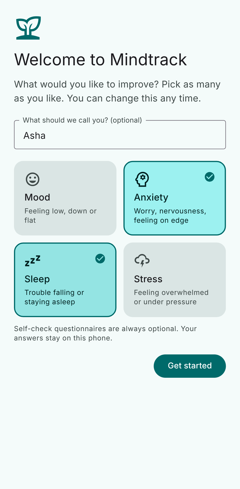
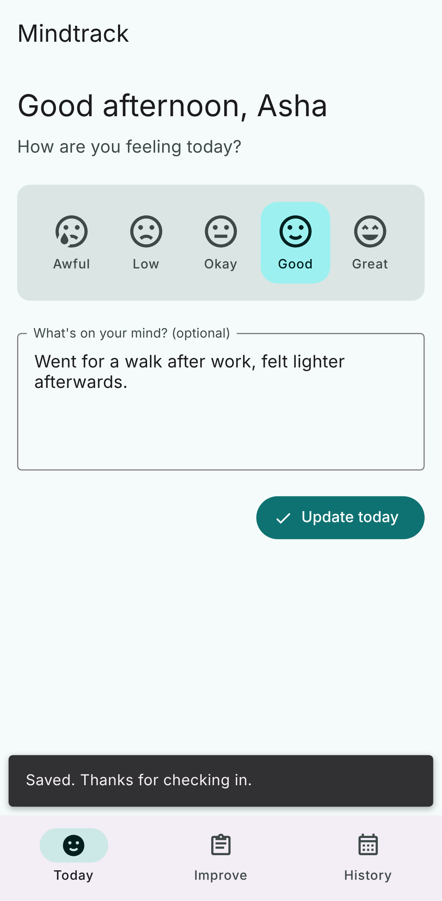
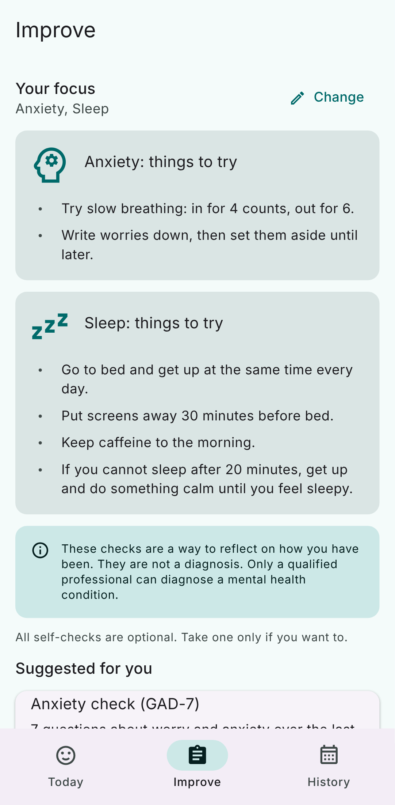
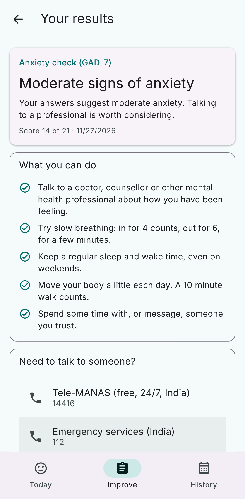
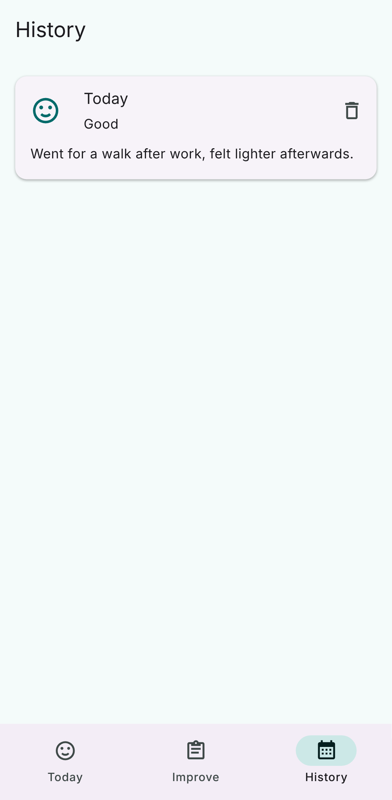

# Mindtrack

Mindtrack is a phone app that helps people look after their mental health. It is about noticing how you feel and finding small things that help, not about charts and statistics.

It runs on Android and iOS (built with Expo and React Native) and follows Google's Material Design 3 look, using [react-native-paper](https://callstack.github.io/react-native-paper/).

| Welcome | Today | Improve | Results | History |
| --- | --- | --- | --- | --- |
|  |  |  |  |  |

## What it does

- **Welcome.** The first time the app opens, people choose what they want to improve: mood, anxiety, sleep or stress. They can change this later.
- **Today.** Pick how you feel from five moods and add an optional note. One entry per day; saving again updates it.
- **Improve.** Tips for each chosen area, plus optional self-checks: a mood check (PHQ-9) and an anxiety check (GAD-7). Checks that match your chosen areas are suggested first. None are required.
- **Results.** After a check you see what your answers suggest in plain words, what you can do next, and helplines. Answering the self-harm question with anything other than "Not at all" always shows a safety message.
- **History.** Your past entries, newest first. Entries can be deleted.

Everything is stored on the phone (AsyncStorage). Nothing is sent to a server, and there is no account yet.

The self-checks are for reflection, not diagnosis, and the app says so on every check and result.

## Running it

You need Node.js 20 or newer.

```bash
npm install
npm start          # then scan the QR code with Expo Go, or press a / i / w
npm test           # unit and screen tests
npm run typecheck  # TypeScript
npm run build:web  # static web build in dist/
```

To build installable Android or iOS apps, use [EAS Build](https://docs.expo.dev/build/introduction/): `npx eas-cli@latest build`.

## Project layout

```
App.tsx                    first-run setup, then bottom navigation
src/screens/               Onboarding, Today, Improve (SelfCheck), History
src/assessments.ts         PHQ-9 and GAD-7 questions, score bands, next steps, helplines
src/areas.ts               focus areas and their tips
src/storage.ts             on-device storage for entries, results and profile
src/theme.ts               Material Design 3 light and dark themes
src/__tests__/             tests
```

## Assumptions to confirm

These were guesses, marked `GUESS` in the code:

- **No real login yet.** "Log in" is a local first-run setup. Real accounts and sync need a backend (for example Firebase), which is a separate decision.
- **Focus areas** are mood, anxiety, sleep and stress.
- **Sleep and stress have tips but no questionnaire.** Common validated ones (ISI, PSS-10) have licensing terms to check first.
- **Helplines are for India** (Tele-MANAS 14416, emergency 112). Other countries need their own numbers.
- **Brand colour** is a calm teal, set in `src/theme.ts`.

## About the questionnaires

PHQ-9 and GAD-7 were developed by Drs. Robert L. Spitzer, Janet B.W. Williams, Kurt Kroenke and colleagues, with an educational grant from Pfizer Inc. No permission is required to reproduce, translate, display or distribute them. The score bands are the published cut-offs. The advice text is general self-care guidance written for this app and should be reviewed by a mental health professional before release.
